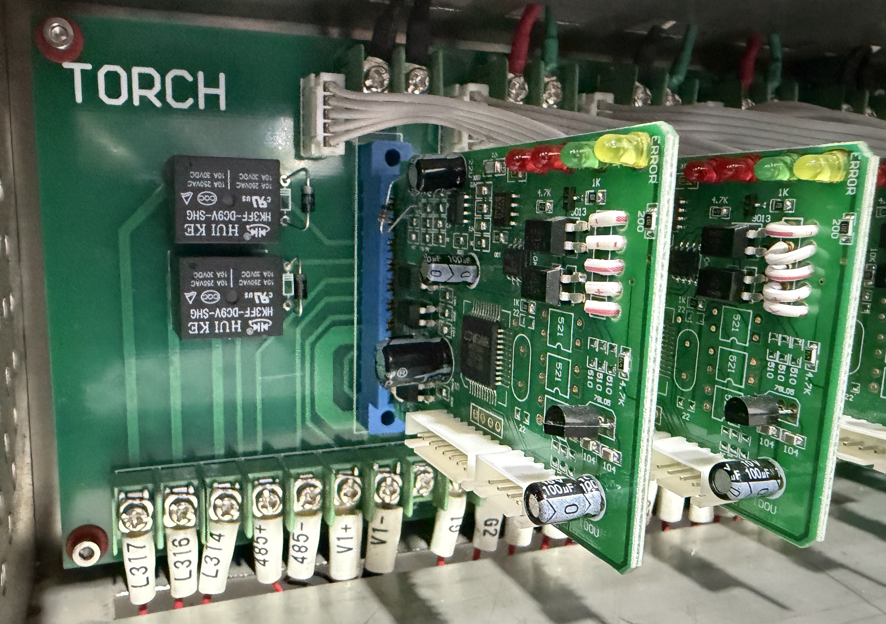
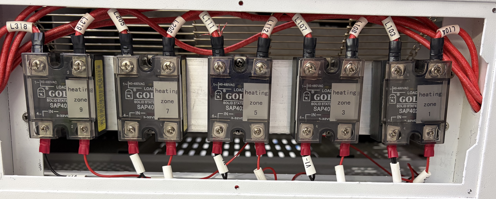
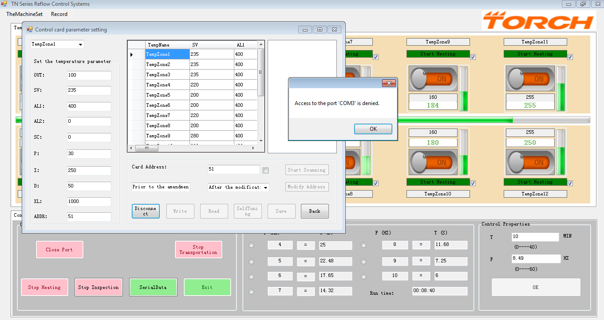

# OpenTorch Reflow Oven Controller

An Open Source replacement control system for the **Torch R350** reflow oven. According to the [Torch R350 product page](http://www.torchsmt.com/R350-Desk-type-reflow-oven-pd52092.html) it's supposed to be a 12-zone (6-top, 6-bottom) oven, but mine is actually a slightly more complicated setup with 12 zones configured as 5-top, 7-bottom with the final top zone being a convection zone that spans the final 3 bottom zones. I don't know why it's different to their website, but it's how mine was built! Mine is the 3-phase version.

Torch reflow ovens are very well made, with solid mechanical structure, well engineered parts, and a robust electrical system using good quality Modbus modules, 40A rated SSRs, braided cable for the high-current loads, genuine Schneider Electric contactors, and Meanwell power supplies. Torch didn't skimp on quality! You can see it everywhere in the hardware. And the chassis is HEAVY. Rock solid.



They even labelled all the SSRs and internal cables that the customer should never see!



I only have personal experience with the R350 model so I don't know what other models are like, but I can't fault the attention to detail that I've seen in mine.

However, the control software is a different story. The R350 is typically controlled from a PC by the vendor's software which is copy-protected using a USB dongle, runs on old 32-bit Windows7 that's out of security support, crashes frequently, and has safety faults. For example it can silently switch heaters back on after the operator clicks the "Stop Heating" button, and its over-temperature cut-off did not work in my testing.

Just using the software it's common to have it lose the ability to connect to its own COM port, and then fail to recover so the entire PC needs rebooting which leaves the oven running in an unsupervised state until the computer is running again and the software reconnects.



This project is a result of my work to reverse-engineer the control system and build my own, so that I can control the oven directly using a simple touch-screen interface without requiring the external Windows PC to be connected.

My current plan is to use a Raspberry Pi with a touchscreen and a USB-RS232 converter connected to the oven's onboard RS232-RS485 converter. My testing so far has been using Python running on a Mac, so moving to a Pi would be a simple switch. However, I'm also considering trying to get it working on an ESP32-S3 with a 7" touchscreen, which would be a lower cost and potentially more stable system because it wouldn't need an SD card, and it could be powered down at any time without a problem.

I expect that I will probably complete the development using Python on my Mac, then transfer to running it on a Pi because the code could work unchanged, and consider moving it all to an ESP32 as a future stretch goal.

An alternative would be to go straight to RS485 and connect internally to the oven's bus, which I've already done using a logic analyser when reverse-engineering the control system. However, my goal is to make this new control system a direct plug-and-play replacement for the Windows PC with zero modifications to the oven.

## Status

- **DONE: Protocol documentation.** Determined from the PC software logs and live RS485 bus captures using a Saleae logic analyser. Found 12 zone cards and 4 profile-thermocouple cards use Modbus RTU at 2400 baud with some non-standard quirks. The conveyor drive (Delta VFD-L) uses Modbus ASCII at 9600 7N2. All of these share one bus, which requires dynamic speed changes on the bus to address different modules and relies on checksum failures to prevent misdirected messages. Ideally this would be split into two buses, but my goal is to retain the original oven hardware unchanged and work within its quirks.
- **DONE: Replacement Phase 0.** A read-only probe tool has been fully tested against both a simulated oven and my real R350 oven. It can see the state of zone modules, reading their setpoints and other attributes. It can also read from the external temperature-profiling thermocouples.
- **DONE: Replacement Phase 1.** Extended the probe tool to allow sending control messages to the various Modbus modules in the oven. Each individual zone has been tested and controlled, along with the VFD for the conveyor motor and the four profiling temperature sensors. The power interlock off zone 1 has been implemented in the code so that other zones can be heated without heating zone 1. Zone locations have been mapped.
- **DONE: Replacement Phase 2.** Rewriting the basic oven simulator to replicate the full oven behaviour, using logged data from the actual oven to implement the responses.
- **IN PROGRESS: Replacement Phase 3.** Rewriting the previously-tested probe tool so that it can run as an oven control service with an internal state machine, implement safety rules, log data, set reflow profiles, and be controlled from a CLI.
- **NOT STARTED: Replacement Phase 4.** Create a web UI that can interact with the oven control service, to provide a GUI with live charts, profiles, external probe capture, and fault display.
- **NOT STARTED: Replacement Phase 5.** Simplify setup and deployment with a process that runs the service on a Pi with autostart, a hardware watchdog, and documented procedures.

## Documents

| File | Contents |
|---|---|
| [CLAUDE.md](CLAUDE.md) | The main technical notes: hardware survey, protocol and register map, capture results, and open questions. Start here for detail. |
| [replacement-plan.md](replacement-plan.md) | Architecture, safety requirements, phases, and hardware for the replacement controller. |
| [vendor-software-issues.md](vendor-software-issues.md) | Problems found with the original software, with evidence. |
| [capture-checklist.md](capture-checklist.md) | How to record bus traffic with a logic analyser while the original software runs. |
| [controller/README.md](controller/README.md) | Setting up and running the controller code. |

## Layout

```
controller/         Replacement controller (Python): oven/ package, probe.py, tests/
tools/              decode_capture.py: decodes Saleae Logic 2 captures of the bus
R350 Capture/       Logic analyser captures of the original software talking to the oven
R350 Screenshots/   Screenshots of the original software
Resources/          Manuals, datasheets and photos of the oven internals
```

## Quick start

```sh
cd controller
python3 -m venv .venv && . .venv/bin/activate
pip install -r requirements.txt
python3 -m unittest
python3 probe.py --fake        # simulated oven
```

## Safety warning!

This software drives a 7.8kW oven on 3-phase mains. Only one master may be on the oven's bus at a time: disconnect the vendor PC before connecting a replacement controller. The heater cards keep heating at their last command if the controller stops, so never leave the oven running unattended.

**Know where the e-stop is at all times!**